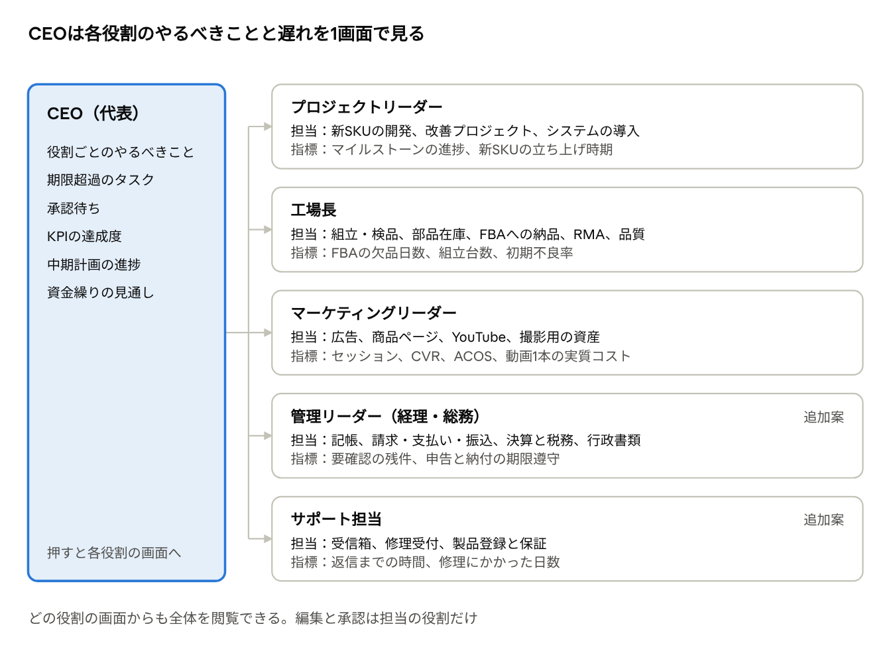
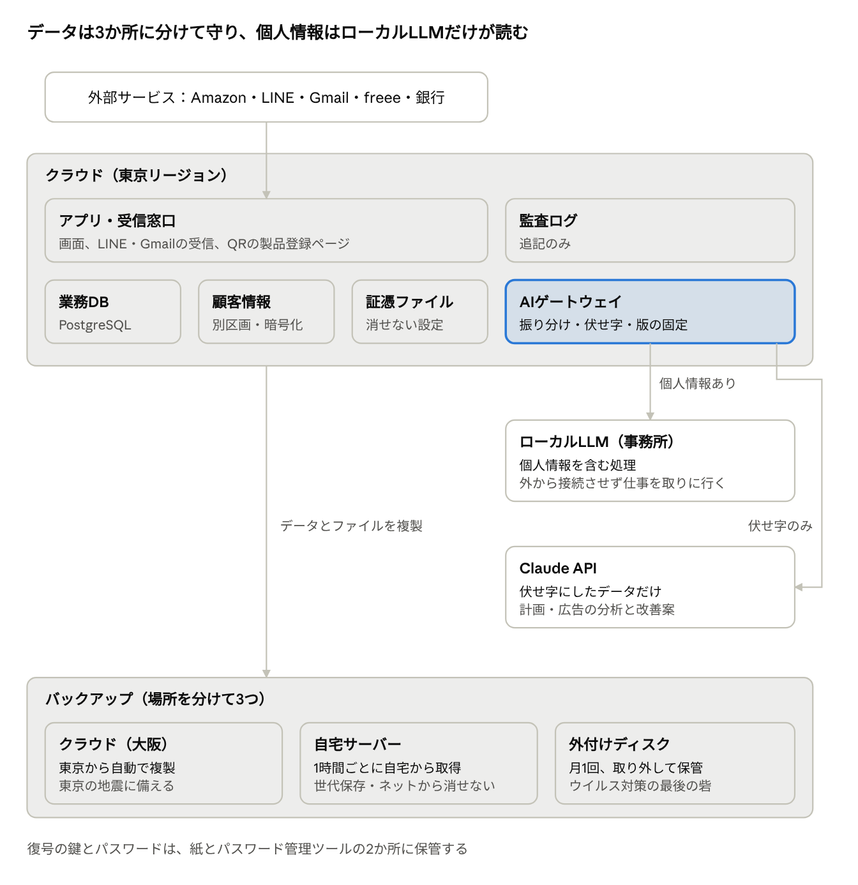
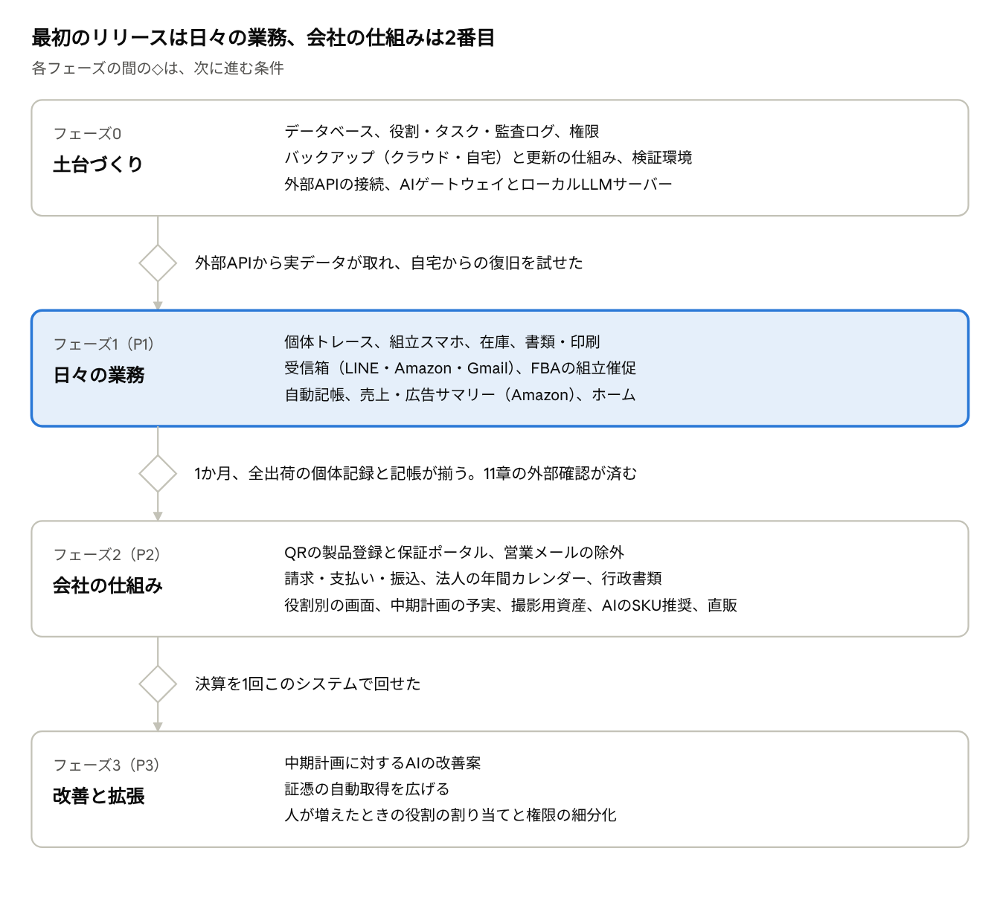

# ZERO-BIT 基幹システム 要件定義書 v0.1

> この文書は claude.ai の要件定義書（Docs）を書き出したものです。正本は Docs 側にあり、更新したら書き出し直してこのファイルを置き換えます。

Oct 24, 2026 · @Takumi

## 1. 目的と前提

このシステムは、Amazon.co.jp（FBA）を主軸にPCを月100台組立・販売する会社を、代表1名とアルバイトで回すための基幹システムです。在庫、個体の追跡、問い合わせ、会計、法人の定型業務、経営計画を1か所にまとめます。AIは下書きと提案を担当し、確定・送信・支払いは人が行います。

| 項目         | 前提                                                                                                                          |
|--------------|-------------------------------------------------------------------------------------------------------------------------------|
| 販売チャネル | Amazon.co.jp（FBA主体）と直販（直販サイトは未定）                                                                             |
| 規模         | 月100台。台数が増えても作り直さずに済む構成にする                                                                             |
| 体制         | 代表が全役割を兼任。組立はアルバイト                                                                                          |
| 正式な会計   | 帳簿・決算書・申告は freee。基幹側は管理会計と記帳データの作成を担う                                                          |
| データの保管 | 本番はクラウド。会社とは別の場所（代表の自宅サーバー）にも複製を置き、地震やウイルスでも復旧できるようにする（7章）           |
| AI           | 個人情報を含む処理は事務所のローカルLLM、含まない分析・計画は Claude。すべてAIゲートウェイを通し、モデルの版を固定する（7章） |
| 画面         | UIモックアップ「ZERO-BIT 基幹システム UI」を基準にする                                                                        |

設計の方針は次の4つです。

- **数字と履歴の正はデータベース。** 在庫・原価・PLをLLMに計算させない。

- **外に出る操作は人が承認する。** 送信、振込、申告、発注、価格や広告の変更が対象。

- **役割と人を分けて持つ。** 今は全役割が代表。人が増えたら割り当てを変えるだけで済むようにする。

- **正式な書類は既存サービスを通す。** 決算書・申告・振込は freee、e-Tax、銀行の仕組みを使い、自作しない。

当面の範囲外は、直販サイト自体の構築と給与計算の本体です（給与は freee 人事労務などの外部サービスを想定）。

## 2. 役割と画面

役割ごとに専用のホーム画面を用意し、担当領域を最初に出します。そこから他の役割の画面もすべて閲覧でき、CEOの画面では各役割のやるべきことと遅れが一覧で分かります。

役割別の画面 · CEOと5つの役割

- 各画面は「やるべきこと」「期限超過」「担当の指標」の3つを共通の型にする。CEOはこれを役割ごとに並べて見る。

- 今は代表が全役割を持つので、ホームは全役割をまとめて表示し、役割ごとに切り替えもできる。

- 組立担当（アルバイト）は役割画面の対象外で、スマホの組立画面だけを使う。

- 管理リーダーとサポート担当は、挙げられた役割に加えた案です。経理・税務と問い合わせ対応の担当をはっきりさせるためです。

## 3. 機能要件

機能は14のモジュールに分けます。優先度は P1＝最初のリリース、P2＝次のリリース、P3＝その後です。タスクと責任の管理は4章、システム構成は7章、バックアップとアップデートは8章に書きます。

| ID  | モジュール                                | 優先度                        |
|-----|-------------------------------------------|-------------------------------|
| F1  | ホーム・役割別の画面（2章）               | P1                            |
| F2  | 受信箱（LINE / Amazonメッセージ / Gmail） | P1（営業メールの除外は P2）   |
| F3  | 個体トレース・管理番号・RMA               | P1                            |
| F4  | 製品登録・保証ポータル（QR）              | P2                            |
| F5  | 生産計画・FBA補充                         | P1（AIのSKU推奨は P2）        |
| F6  | 組立・検品（スマホ）                      | P1                            |
| F7  | 在庫・資産管理                            | P1（撮影用・廃棄の区分は P2） |
| F8  | 会計・自動記帳（freee連携）               | P1                            |
| F9  | 請求・支払い・振込                        | P2                            |
| F10 | 法人の定型業務・行政書類                  | P2                            |
| F11 | 中期経営計画と進捗                        | P2（AIの改善案は P3）         |
| F12 | タスクと責任の管理（4章）                 | P1                            |
| F13 | 書類・印刷                                | P1                            |
| F14 | 売上・広告サマリー                        | P1（直販の広告は P2）         |

### F2 受信箱

- LINE・Amazonメッセージ・Gmailをタブで分けて表示し、未返信の件数と返信期限を出す。

- 本文から管理番号・注文番号・シリアルを抽出し、該当する個体や注文を自動で横に表示する。

- **LINE**：自動応答で管理番号と症状を聞き取る。修理受付の確定と有償の見積は、人が承認してから送る。

- **Amazon**：通知メールを5分ごとに取り込み、AIが下書きを作る。送信は人が行い、登録アドレスから返す。24時間の返信期限を表示する。

- **Gmail**：複数アドレスを Google Workspace に集約し、受信アドレス別に絞り込める。返信は受け取ったアドレスから送る。引用と署名を除いてチャット表示にする。

- **営業メールの除外（P2）**：ルールとAIで判定し、除外の理由を表示する。「受信箱に戻す」操作を判定に反映する。注文番号・管理番号を含むもの、既存の顧客や仕入先からのものは除外しない。

### F3 個体トレース・管理番号・RMA

- 管理番号は「ZB-年月-連番」。本体の外側と箱に、QR入りの剥がれにくいシールを貼る。

- 機種ごとの構成表は、枠ごとに「必ず付ける／付けなくてもよい」を決める。Amazon 用の機種は型番を固定して必ず付け、直販の機種はケースファンなどを付けなくてもよくできる。「自由枠」には登録済みの部品なら種類を問わず付けられる（Wi-Fiカード、追加のSSDなど）。在庫を使わない作業や部品は、個体のメモとして文字で残す。

- 1台ごとに次を紐づける。使用パーツ（シリアル、購入日、購入先、単価、証憑、元箱の棚番）、組立者、検品者と検品記録、出荷日、販売チャネル、注文番号、顧客、保証期限、問い合わせ・修理・RMAの履歴。

- 高額パーツ（GPU・メモリなど、基準額は設定で変えられる）は元箱を保管し、棚番を記録する。RMAの申請書を作り、発送から交換品の受領まで追跡する。

- 証憑は仕入れ用アドレスに届く注文確認メールと添付PDFから自動で取り込む。ログインが必要なショップは当面手動でアップロードし、自動化は後で検討する。

- 仕入れは「注文済み → 輸送中 → 一部入荷 → 入荷済み」で追う。発送の連絡が来たら運送会社と追跡番号を記録し（1つの注文が何個口にも分かれてよい）、届いた荷物は送り状の追跡番号のバーコードを読んで該当の仕入れを開き、箱のシリアルを読んで1個ずつ在庫に入れる。

- 注文確認メールから仕入れの下書きを作る。ショップごとのメールの形に合わせて注文番号・注文日・明細・金額を読み取り、明細の合計とメールの合計をプログラムで検算する。合わないものは確定させない。人が部品の型番を選んで確定すると仕入れになり、ショップの商品名と型番の対応は覚えて次から自動で当てる。メールの本文は保存しない（宛名・住所が入るため）。ドスパラ・Joshin web・Amazon.co.jp に対応し、ほかのショップは順に足す。Amazon のメールは商品名が途中までしか書かれていないので、確定のときに型番を確かめる注意を出す。

- 領収書・保証書・納品書は「共有の取り込みフォルダ」に集める。サイトからダウンロードしたものも、実店舗のレシートをドキュメントスキャナーで読んだものも、そこに置けば取り込まれ、本文に注文番号があれば仕入れに自動でひもづく。画面からのアップロード（スマホで撮影も可）でも取り込める。取り込んだファイルは書き換え・削除できず、同じファイルは二重に取り込まない。領収書・請求書は日付・取引先・金額がそろうまで「要確認」にする（電子帳簿保存法の検索要件）。

### F4 製品登録・保証ポータル（QR）

- 本体外側のQRから登録ページを開く。QRには管理番号と推測されにくいトークンを入れる。

- 登録すると保証が1年から2年に延長される。

- 登録項目は氏名、連絡先（メールかLINE）、購入チャネル。**FBAで購入した場合は注文番号を必須にする。** FBAは出荷の時点でどの個体が誰に届くか分からないため、ここで管理番号と注文を紐づける。

- 注文番号は SP-API で確かめる。注文が存在するか、SKUが管理番号と一致するか、既に別の個体で登録されていないかを確認する。

- 直販の購入者は出荷時に注文と管理番号が紐づいているので、注文番号の入力は不要。

- 登録後のページでは、搭載パーツ、出荷日、保証終了日、修理の状況を確認でき、問い合わせと修理依頼を出せる。個人情報を表示する前に、メール認証かLINEログインで本人確認する。

- 登録ページではレビュー依頼、割引、直販への誘導、販促目的のメール収集をしない。Amazonの方針に触れるおそれがあるためで、印刷前に確認する（11章）。

### F5 生産計画・FBA補充

- FBA在庫、輸送中の数、販売ペースから欠品日を出し、組立からFBA受領までの日数を引いて「組立を始める期限」を出す。日数は設定で変えられる。

- 期限が近づいたら工場長のタスクを作り、ホームで催促する。

- FBA納品プランの作成を補助する。

- **AIのSKU推奨（P2）**：セッション、CTR、CVR、粗利、在庫から生産数を理由つきで提案し、足りない部品と発注リストを出す。

### F6 組立・検品

- スマホで管理番号とパーツのバーコードを読むだけで記録する。指示と違う型番を読んだらその場で止める。

- 配線の写真、作業時間、検品チェックリスト（負荷試験、温度、騒音）を残す。検品は組立と別の人が行う。

- 組立担当は財務と顧客の情報を見られない。

### F7 在庫・資産管理

在庫と資産を次の区分で持ちます。区分を変えるときは「振替」として、日付・理由・金額・承認者を記録します。会計上の扱いは案で、税理士と確定します。

| 区分              | 例                                     | 会計上の扱い（案）                         | 管理会計の帰属（案） |
|-------------------|----------------------------------------|--------------------------------------------|----------------------|
| 部品在庫          | 仕入れたパーツ                         | 棚卸資産                                   | 製造                 |
| 仕掛品            | 組立中の個体                           | 棚卸資産                                   | 製造                 |
| 製品在庫          | 自社・FBA・輸送中の完成品              | 棚卸資産                                   | 販売                 |
| 撮影用（YouTube） | レビュー動画に使う製品やパーツ         | 振替時に広告宣伝費か器具備品（金額で判定） | マーケティング       |
| 撮影後の売却      | 中古・アウトレットとして他の場所で売る | 売上（中古）。帳簿価額との差額も記録       | マーケティングに戻す |
| 社内利用          | 検証機、工具                           | 器具備品または消耗品                       | 管理                 |
| RMA中             | 代理店へ返送中のパーツ                 | 交換待ちとして別管理                       | 製造                 |
| 廃棄・除却        | 不良や破損の部品                       | 廃棄損。写真と廃棄の証明を保存             | 発生した部門         |

撮影用の機材を売った収益は、**会計上は会社全体の売上、管理会計上はマーケティングの収益**として扱う案です。こうすると「動画1本に実際いくらかかったか（取得原価から売却額を引いた額）」がマーケティングの画面で見えます。撮影用にも管理番号を付け、売るときに「撮影使用品」と分かるようにします。フリマアプリなど他チャネルの売上はCSVで取り込みます。

### F8 会計・自動記帳

- Amazonのペイメントレポートを入金ごとに売上・手数料・FBA費用に分け、freeeに取引として登録する。直販の決済データも同じように扱う。

- 仕入れは領収書の読み取り結果とカード明細を突き合わせて1件にし、二重に登録しない。金額が合わないものだけ要確認にする。

- 月末に在庫の評価額を出し、棚卸の仕訳を登録する。取引には部門タグ（製造・販売・マーケティング・管理）を付ける。

- 電子取引のデータは、日付・金額・取引先で検索できる形で保存する（電子帳簿保存法）。仕入れの請求書・領収書はインボイス登録番号を確かめる。

- 管理会計のPLを日次で、SKU別・チャネル別・部門別に出す。

### F9 請求・支払い・振込

- 見積書・請求書（適格請求書の記載項目を満たす）・領収書を発行し、入金を消し込む。

- 支払い予定（仕入先の請求書、カード引落、税金、社会保険料）を一覧にし、資金繰りの見込みを出す。

- 振込データはシステムが作り、実行は人が承認したうえで銀行側でもう一度承認する（二段階）。振込先口座の変更は、別の経路で本人に確認してから登録する。

### F10 法人の定型業務・行政書類

決算期と会社の状況（従業員の有無、消費税の課税事業者かなど）から年間カレンダーを作り、期限のあるタスクを担当の役割つきで自動で作ります。下の表は代表的なもので、初期設定のときに税理士と確定します。

| 時期                                       | 業務                                         | 基幹がやること                                   |
|--------------------------------------------|----------------------------------------------|--------------------------------------------------|
| 毎月10日（納期の特例なら7月10日・1月20日） | 源泉所得税の納付                             | 給与データから納付額を集計し、納付をタスク化     |
| 1月31日                                    | 法定調書合計表・給与支払報告書・償却資産申告 | 対象データと固定資産の一覧を用意                 |
| 決算日の翌日から2か月以内                  | 法人税・地方税・消費税の申告と納付           | 決算チェックリスト、棚卸、未処理の取引の洗い出し |
| 決算後（定款の定めによる）                 | 定時株主総会と議事録                         | 議事録の下書き                                   |
| 期首から3か月以内                          | 役員報酬の改定                               | 改定の要否を確認するタスク                       |
| 前期の税額による                           | 中間申告                                     | 対象かどうかを判定してタスク化                   |
| 6月1日〜7月10日                            | 労働保険の年度更新                           | 賃金総額を集計                                   |
| 7月1日〜10日                               | 社会保険の算定基礎届                         | 4〜6月の報酬を集計                               |
| 12月〜1月                                  | 年末調整                                     | 必要書類の回収状況を管理                         |
| 随時                                       | 登記変更（役員の任期など）、採用時の届出     | 期限の設定と書類の下書き                         |

申告書と届出は freee や税理士を通して e-Tax・eLTAX・e-Gov で提出します。基幹は必要なデータをまとめ、提出した控えと受信通知を保存します。AIはチェックリスト、下書き、数字の突合を担います。

### F11 中期経営計画と進捗

- 3〜5年の目標（売上、営業利益、台数、チャネル比率、平均単価、粗利率、人員、設備投資）を入力し、年・四半期・月に分解する。

- 売上＝セッション×CVR×単価のような指標の木を作り、月ごとに予実を比べる。乖離の大きい指標とその担当の役割を特定する。

- **AIの改善案（P3）**：乖離の原因をデータの根拠つきで示し、打ち手、期待効果、担当の役割を提案する。承認された案はタスクになる。

- 月次レビューの報告書を自動で作り、CEOの画面に出す。

### F13 書類・印刷

- テンプレート：納品書、保証書（登録で2年に延びる案内とQR）、初期設定ガイド、修理受付票、見積書、請求書、RMA申請書。

- 管理番号ごとに自動で作り、PDFとして保存し、まとめて印刷できる。

### F14 売上・広告サマリー

- Amazonと直販をタブで切り替え、売上・粗利・貢献利益・出荷台数と、広告費・ACOS・ROAS・キャンペーン別の状態を並べる。

- 損益分岐のACOSなどの基準値は設定で変えられる。入札や予算の変更案は、承認してから反映する。

## 4. タスクと責任の管理

すべてのタスクに、誰の役割か、いつまでにやるべきだったか、誰がいつ実行したか、誰が承認したかを記録します。履歴は後から書き換えられない形で残します。

| 項目             | 内容                                                                       |
|------------------|----------------------------------------------------------------------------|
| 担当             | 役割（例：工場長）と、その時点で役割を持っていた人                         |
| 承認者           | 承認が必要なタスクの承認役割と、承認した人                                 |
| 発生元           | 定常業務カレンダー、FBAの催促、受信箱、AIの提案、手動                      |
| 期限と実行予定日 | いつまでに、いつやる予定だったか                                           |
| 実行日時と実行者 | 人かシステム（AI含む）か。システムが実行した場合も、責任は担当の役割にある |
| 状態             | 未着手、進行中、承認待ち、完了、期限超過、取消                             |
| 証跡             | 送ったメッセージ、作った書類、振込や申告の受付番号など                     |
| 遅延の理由       | 期限を過ぎて完了したときに入力を必須にする                                 |

運用のルールは次のとおりです。

- タスクは役割に割り当て、役割に人を割り当てる。担当者が変わっても、過去の担当者は記録に残る。

- 期限を過ぎたタスクは自動で「期限超過」になり、CEOの画面に役割ごとに出る。

- 作成・状態の変更・承認・取消はすべて監査ログに残る。監査ログは追記のみで、編集も削除もできない。

- AIや自動処理が実行したものは、どの承認に基づいて実行したかを一緒に残す。

- 1人で運用している間も承認の手順は省かない（自分で承認する）。人が増えたときにそのまま分業できる。

- 振込や申告など取り消せない操作は、確認画面で金額などをもう一度入力させる。

## 5. AIの役割と制約

AIが担うのは下書き、抽出、分類、提案です。外に出る操作とお金が動く操作は、人の承認を必須にします。個人情報を含む処理はローカルLLM、含まない処理は Claude が担当します（振り分けは7章のAIゲートウェイ）。

| 業務           | 使うAI   | AIがやること                       | 人がやること                                   |
|----------------|----------|------------------------------------|------------------------------------------------|
| Amazonへの返信 | ローカル | 下書き                             | 確認して送信                                   |
| LINEの応答     | ローカル | 定型の聞き取りと案内は自動で送信   | 修理受付の確定、有償の見積、返金は承認して送信 |
| Gmail          | ローカル | 分類、営業メールの除外、下書き     | 確認して送信                                   |
| 証憑・記帳     | ローカル | 領収書の読み取り、勘定科目の推定   | 推定が割れたもの、金額が合わないものの確認     |
| 振込           | 使わない | ―（振込データはプログラムで作る）  | 承認と銀行での実行                             |
| 申告・行政書類 | ローカル | チェックリスト、下書き、数字の突合 | 提出（税理士の確認を挟む）                     |
| 広告           | Claude   | 入札・予算の変更案                 | 承認して反映                                   |
| 生産           | Claude   | 生産数の推奨                       | 生産指示                                       |
| 経営計画       | Claude   | 乖離の原因と改善案                 | 採用の判断                                     |

在庫、原価、振込金額など数字で決まる処理は、AIではなく普通のプログラムで作ります。ローカルLLMが止まっても、これらは動き続けます。

守るべき制約は次のとおりです。

- **AmazonのAgent Policy（2026年3月4日から）**：AIエージェントは自動システムであることを明示し、ポリシーを常に守り、Amazonから求められたらアクセスをやめる。Amazonへのアクセスは SP-API と広告APIだけにし、セラーセントラルの画面を自動操作しない。ログイン情報をツールに渡さない。（[告知](https://sellercentral.amazon.com/seller-forums/discussions/t/84e3f6b1-42f7-4cf3-a189-a5cc8d78d838)）

- **AI開発への利用制限**：AmazonのデータでAIモデルを学習させない。ローカルLLMも推論にだけ使い、Amazonのデータで追加学習しない。Claude API は入力が学習に使われない契約条件を確認する。

- **個人情報は Claude に渡さない**：AIゲートウェイで氏名・住所・電話・メール・LINE ID・注文番号を「顧客A」のように置き換えてから送る。置き換えに失敗したら送らずに止める。

- **数字はデータベースから**：在庫、金額、日付はデータベースの値を使い、AIは文章にするだけにする。下書きと提案には根拠を並べて表示する。

- **答え方を勝手に変えない**：ローカルも Claude もモデルとプロンプトの版を固定し、どの版で作ったかを記録する。切り替える前に、過去の問い合わせと承認済みの返信で作ったテストで答えを比べる。

## 6. 外部連携

最初のリリースでつなぐのは、Amazon・LINE・Gmail・freee・Claudeと、事務所のローカルLLMです。銀行と申告は2つ目のリリースでつなぎます。

| 連携先                             | 用途                                                                       | 方式                               | 優先度 |
|------------------------------------|----------------------------------------------------------------------------|------------------------------------|--------|
| Amazon SP-API                      | 注文、FBA在庫、ペイメント、ビジネスレポート、FBA納品、製品登録時の注文確認 | API                                | P1     |
| Amazon広告API                      | 広告の実績、承認済みの変更の反映                                           | API                                | P1     |
| Amazonの通知メール                 | 購入者メッセージの取り込みと返信                                           | Gmail経由                          | P1     |
| LINE Messaging API                 | 受信、自動応答、送信、製品登録でのログイン                                 | WebhookとAPI                       | P1     |
| Gmail API（Google Workspace）      | 複数アドレスの受信と送信、証憑メールの取り込み                             | API                                | P1     |
| freee会計                          | 取引の登録、試算表・決算書の参照                                           | API                                | P1     |
| ローカルLLM（事務所のGPUサーバー） | 個人情報を含む下書き、取り込み、分類、読み取り                             | AIゲートウェイへサーバー側から接続 | P1     |
| Claude API                         | 中期計画・広告・生産の分析と改善案（個人情報なし）                         | API（差し替え可能）                | P1     |
| 銀行                               | 入出金明細、振込                                                           | 銀行APIまたは振込ファイル          | P2     |
| 給与サービス（freee人事労務など）  | 源泉所得税、社会保険、年末調整のデータ                                     | API                                | P2     |
| 配送業者                           | 送り状、追跡                                                               | APIまたはCSV                       | P2     |
| Google広告・Meta広告               | 直販の広告実績                                                             | API                                | P2     |
| 直販サイト（未定）                 | 注文と決済                                                                 | API                                | P2     |
| e-Tax・eLTAX・e-Gov                | 申告と届出                                                                 | freeeまたは税理士経由              | P2     |

## 7. システム構成

業務データはクラウド（東京）に置き、大阪リージョンと代表の自宅サーバーに複製します。AIは、個人情報を扱う事務所のローカルLLMと、扱わない Claude に分け、すべてAIゲートウェイを通します。

システム構成 · クラウド、AI2系統、バックアップ3か所

クラウドが地震で止まっても大阪から、ウイルスでクラウドが壊されても自宅から、両方やられても外付けディスクから戻せます。

### 各部分の役割

| 部分               | 置き場所                                     | 役割                                                                                 |
|--------------------|----------------------------------------------|--------------------------------------------------------------------------------------|
| アプリ・受信窓口   | クラウド（東京）                             | 画面、LINE・Gmailの受信、QRの製品登録ページ。24時間動かす                            |
| 業務データベース   | クラウド（東京）                             | 個体・部品・注文・在庫・タスクなど。顧客は番号だけで参照する                         |
| 顧客情報           | クラウド（東京）の別区画                     | 氏名・住所・電話・メール・LINE ID。暗号化し、読めるのはローカルLLMと権限のある人だけ |
| 証憑・書類ファイル | クラウドのファイル保管                       | 一定期間は削除も上書きもできない設定                                                 |
| 監査ログ           | クラウド                                     | 追記のみ                                                                             |
| AIゲートウェイ     | クラウド                                     | すべてのAI呼び出しの入口                                                             |
| ローカルLLM        | 事務所のGPUサーバー                          | 個人情報を含む処理。外からの接続は受けず、サーバー側から仕事を取りに行く             |
| Claude             | Anthropic のAPI                              | 伏せ字にしたデータだけを受け取り、分析と提案を行う                                   |
| バックアップ       | 大阪リージョン、自宅サーバー、外付けディスク | 詳しくは8章                                                                          |

### AIゲートウェイ

- **振り分け**：個人情報を含む処理はローカル、含まない処理は Claude に送る。判断できないものはローカルに回す。

- **伏せ字**：Claude に送る前に個人情報を置き換える。置き換えに失敗したら送らない。

- **版の固定と記録**：モデルとプロンプトの版を固定し、呼び出しごとに使ったAI・版・伏せ字の有無を記録する。

- **切り替え前の比較**：過去の問い合わせと承認済みの返信をテスト用に取っておき、モデルを替える前に答えを比べる。

- **片方が止まったとき**：Claude が止まったら、分析と提案はローカルで代わりに行う。ローカルが止まったら、個人情報を含む下書きは復旧まで待ち、ホームに表示する。伏せ字にして Claude に回すかは11章で決める。

### ローカルLLMサーバー

- 自社で組んだGPUワークステーション1台。月100台規模の問い合わせと証憑なら1台で足りる見込み。

- 無停電電源装置（UPS）を付け、停電時に安全に止まるようにする。

- モデルのファイル、設定、プロンプトは自宅サーバーにも保存する。予備機を組めば同じ状態に戻せる。

- インターネットからの接続は受け付けない。

### 地震・ウイルスからの復旧

どの場合も、少なくとも1か所のバックアップから復旧できるようにします。目標時間は提案値です。

| 起きること                                     | 影響                                     | 復旧のしかた                                                         | 目標                                          |
|------------------------------------------------|------------------------------------------|----------------------------------------------------------------------|-----------------------------------------------|
| データの誤削除・誤更新                         | 一部のデータ                             | クラウドで直前の時点に戻す                                           | 1時間以内                                     |
| 事務所のLLMサーバーの故障                      | 個人情報を含む下書きが止まる（他は動く） | 予備機を組み、自宅のモデルと設定を戻す                               | 1営業日                                       |
| 地震などで東京リージョンが止まる               | システム全体が止まる                     | 大阪の複製から立ち上げる                                             | 4時間以内                                     |
| ウイルスや乗っ取りでクラウドのデータが壊される | クラウドのデータとその複製               | 自宅サーバーの世代から、新しく作ったクラウド環境に戻す               | 2営業日以内。失うのは最大1時間分              |
| クラウドと自宅サーバーが同時に壊される         | 3か所のうち2か所                         | 外付けディスクから戻し、差分はAmazon・freee・LINE・Gmailから取り直す | 失うのは最大1か月分（外部から取り直せない分） |
| 自宅サーバーの故障                             | バックアップが1か所減る                  | 交換して取り直す                                                     | 1週間以内                                     |

ウイルス対策として、次のことを守ります。

- 自宅サーバーは自分からデータを取りに行く。クラウド側には自宅に書き込む権限を持たせない。

- 自宅では世代ごとに読み取り専用のスナップショットを残し、ネット越しには消せないようにする。

- クラウドのバックアップも一定期間は削除できない設定にし、普段使う管理者とバックアップ用のアカウントを分ける。

- バックアップの変化量が急に増えたら警告を出す（暗号化されている兆候）。

- バックアップは暗号化する。復号の鍵とパスワードは、紙とパスワード管理ツールの2か所に分けて保管する。鍵をなくすと戻せない。

- 復旧の手順書を作り、四半期に1回、自宅のバックアップから検証環境に全部戻す訓練をする。

## 8. 非機能要件

クラウド上で動かし、ブラウザからPCでもスマホでも使えるようにします。バックアップは「15分前の状態に戻せて、4時間以内に復旧できる」ことを目標にします（提案値）。構成と災害時の復旧の手順は7章に書きます。

### セキュリティと権限

- ログインは2段階認証を必須にする。代表・社員は会社の Google Workspace アカウントでログインし、2段階認証は Workspace 側で必須にする。組立担当（バイト）にはメールアドレスを作らず、代表が登録した組立用の端末で名前と4桁のPINを入れてログインする（「登録済みの端末」と「PIN」の2つがそろって入れる）。組立担当は組立の画面だけ使え、12時間で自動ログアウトする。PINは5回続けて間違えるとロックする。

- 画面と操作の権限は役割ごとに決める。閲覧は広く、編集と承認は担当の役割だけにする。

- 通信と保存データを暗号化する。APIキーなどの秘密情報は専用の保管場所に置き、コードに書かない。

- 顧客の個人情報は利用目的を公開し、保管期間を過ぎたら削除または匿名化する。

- すべての操作を監査ログに残す（4章）。

### バックアップ

| 対象                                                | 保管場所                                                               | 頻度         | 保持                                                     |
|-----------------------------------------------------|------------------------------------------------------------------------|--------------|----------------------------------------------------------|
| データベース                                        | クラウド（東京）の自動スナップショットと変更ログ（任意の時点に戻せる） | 常時＋日次   | 日次30日分、月次12か月分、年次は法定の保存期間           |
| データベース                                        | 大阪リージョンへの複製                                                 | 常時         | 東京と同じ                                               |
| データベースとファイル                              | 代表の自宅サーバー（自宅側から取りに行く。読み取り専用の世代を残す）   | 1時間ごと    | 1時間ごとの世代を7日分、日次90日分、月次は法定の保存期間 |
| データベースとファイル                              | 外付けディスク（ネットから切り離して保管）                             | 月1回        | 直近3世代                                                |
| 証憑・書類のファイル                                | クラウドのファイル保管（一定期間は削除できない設定）と大阪への複製     | 保存のたび   | 法定の保存期間                                           |
| 設定・テンプレート・プロンプト・ローカルLLMのモデル | 自宅サーバーで世代管理                                                 | 変更のたび   | 全世代                                                   |
| 復元の試験                                          | 毎月はクラウドから、四半期ごとに自宅から検証環境へ戻す                 | 毎月・四半期 | 結果を記録                                               |

データはクラウド（東京・大阪）、自宅サーバー、外付けディスクに分けて置きます。帳簿と証憑の保存期間は原則として7年で、欠損金が出た年度の分は10年です。

### アップデート

- バージョン番号を付け、変更内容をリリースノートとして画面で見られるようにする。

- 本番と同じ構成の検証環境で確かめてから、本番に反映する。

- 更新の直前に自動でバックアップを取り、問題があれば1つ前の版に戻せるようにする。データベースの構造変更は手順をコードとして管理する。

- 更新は業務時間外に行い、前もって画面で予告する。

- 外部APIの仕様変更や廃止の予定を監視する。AIモデルを替えるときは、旧い版と出力を比べてから切り替える。

- 使っているソフトの脆弱性を定期的に確かめ、更新する。

- 設定画面に「今のバージョン」「最後のバックアップ」「次の更新予定」を表示する。

### その他

- 主要な画面は2秒以内に表示する（目標値）。

- システムが止まっても、問い合わせはAmazon・LINE・Gmail側に残る。復旧後に取りこぼしなく取り込めるようにする。

## 9. 主要データ

中心は「管理番号（個体）」です。顧客の個人情報は別区画に分け、他のデータは顧客番号だけを持ちます。部品・注文・顧客・問い合わせ・修理はすべて個体を通してつながります。詳しいテーブル設計は次の工程で作ります。

| データ                           | 主な項目                                             | つながる先                 |
|----------------------------------|------------------------------------------------------|----------------------------|
| 個体（管理番号）                 | SKU、状態、区分、組立者、検品記録、出荷日、保証期限  | 部品、注文、製品登録、修理 |
| 部品（個品）                     | 型番、シリアル、単価、区分、元箱の棚番               | 仕入れ、個体、RMA          |
| 部品マスタ                       | 型番、種類、箱を保管するか                           | 構成表                     |
| SKUと構成表                      | SKU、必要な部品と数量                                | 個体、生産計画             |
| 仕入れ                           | 仕入先、注文番号、金額、インボイス登録番号、証憑     | 部品、取引                 |
| 注文                             | チャネル、注文番号、日付、金額、FBAかどうか          | 個体、顧客                 |
| 顧客                             | 顧客番号、法人かどうか                               | 注文、会話、製品登録       |
| 顧客の個人情報（別区画・暗号化） | 氏名、住所、電話、メール、LINEのID、保管期限         | 顧客番号だけ               |
| 製品登録                         | 管理番号、注文番号、登録日、延長後の保証期限         | 個体、顧客                 |
| 会話                             | チャネル、メッセージ、下書き、送信者、返信期限       | 顧客、個体、注文           |
| 修理・RMA                        | 症状、有償か無償か、見積、状態                       | 個体、部品                 |
| 在庫の振替                       | 品目、数量、変更前と後の区分、理由、承認者           | 部品、個体、取引           |
| 取引                             | freeeの取引ID、部門、元データ                        | 仕入れ、注文、請求・支払い |
| 請求・支払い・振込               | 相手、金額、期日、承認、銀行の受付番号               | 取引、タスク               |
| 経営計画と指標                   | 期間、指標、目標、実績                               | 役割、タスク               |
| タスク                           | 役割、担当者、期限、実行記録、証跡                   | すべてのデータ             |
| AIの呼び出し記録                 | 使ったAI、モデルとプロンプトの版、伏せ字の有無、結果 | 会話、取引、タスク         |
| 役割・利用者・権限               | 役割とその期間の担当者                               | タスク、監査ログ           |
| 監査ログ                         | いつ、誰が、何を、何から何に変えたか                 | すべてのデータ             |

## 10. 段階リリース計画

最初に「日々の業務」を動かし、実際に1か月回してから「会社の仕組み」に進みます。各フェーズの期間は、開発の体制が決まってから見積もります。

段階リリース · 4フェーズと3つの判定

フェーズ1の間に11章の外部確認を済ませておくと、フェーズ2のQR登録や法人カレンダーを待たずに始められます。

## 11. 未決事項・要確認事項

法律と税務に関わる6件は、開発に入る前に外部に確認します。残りは代表が決める事項です。

外部に確認するもの：

- [ ] 撮影用の機材、中古としての売却、廃棄の会計処理（勘定科目、少額資産の扱い）。確認先：税理士

- [ ] 法人の年間カレンダー（決算期、消費税の課税状況、中間申告、申告期限の延長の特例）。確認先：税理士

- [ ] QRの製品登録と保証延長がAmazonの方針に合うか。保証登録ページは許される一方、メール収集やAmazon外への誘導は問題になりうるとされている（[解説記事](https://www.supplykick.com/blog/amazon-product-inserts-guide)、Amazonの公式文書ではない）。確認先：Amazonセラーサポート（印刷前）

- [ ] 自社ブランドのPCを売る事業者として、使用済みPCの回収とリサイクルの義務があるか。資源有効利用促進法ではPCメーカーに回収・リサイクルが義務付けられ、自作PCはパソコン3R推進協会が引き取っている（[文京区の案内](https://www.city.bunkyo.lg.jp/tetsuzuki/recycling/kateigomisigen/pasokon.html)）。確認先：パソコン3R推進協会

- [ ] 中古のパーツやPCを買い取って売る場合の古物商許可の要否。自社で使った機材を売るだけなら影響は小さい見込み。確認先：管轄の警察署

<!-- -->

- [ ] 顧客情報の扱い（個人情報はローカルで処理し、外部のAIには伏せ字にして送る運用）が個人情報保護法上問題ないか、個人情報の取り扱い方針にどう書くか。確認先：弁護士などの専門家

代表が決めるもの：

- [ ] 保証規定（2年目に保証する範囲、登録の期限）。ギフトで受け取って注文番号が分からない人の扱い

- [ ] 役割の定義。特にプロジェクトリーダーの担当範囲と、管理（経理・総務）とサポートを役割として置くか

- [ ] 中期経営計画の目標値

- [ ] 直販サイトの仕組み（Shopify、BASE、自社サイトなど）

- [ ] 振込をつなぐ銀行（APIの有無）

- [ ] メールを Google Workspace に集約するか

- [ ] 管理番号シールの仕様（素材、貼る位置、箱への貼付）

- [ ] 広告の基準値（損益分岐のACOSなど）と、組立からFBA受領までの日数の実測値

- [ ] 個人情報の取り扱い方針（製品登録ページに載せる）

- [ ] ローカルLLMのモデル選び。過去の問い合わせで日本語の返信の質を確かめてから決める

- [ ] ローカルLLMが止まったとき、個人情報を含む下書きを待つか、伏せ字にして Claude に回すか

- [ ] 自宅サーバーの回線、無停電電源装置（UPS）、外付けディスクの保管場所

- [ ] バックアップの鍵とパスワードを保管する2か所
